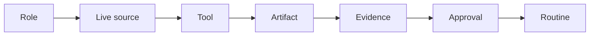

# J.A.R.V.I.S.

**Joint Ambient Ready Variance Intelligence System**

One operator. Durable roles. Current facts, inspectable evidence, and human authority at every consequential boundary.

[](https://github.com/basementjarvisunleashed-a11y/jarvis-estate/actions/workflows/validate.yml)
[](LICENSE)
[](https://github.com/basementjarvisunleashed-a11y/jarvis-estate/commits/main)

**Local Jarvis is live.** On 2026-10-27 the downloadable Windows build landed in [`local-jarvis/`](local-jarvis/README.md). The public site is [GitHub Pages](https://basementjarvisunleashed-a11y.github.io/jarvis-estate/).

## Contents

- [Overview](#overview)
- [Get Local Jarvis](#get-local-jarvis)
- [Architecture](#architecture)
- [Repository structure](#repository-structure)
- [Security](#security)
- [Contributing](#contributing)
- [License](#license)

## Overview

J.A.R.V.I.S. is an operating system for a personal AI estate. Named roles own durable jobs. Changing facts are re-read from the system that owns them. A fluent "done" is not proof: consequential work ends in an artifact the operator can inspect. Nothing is sent, spent, published, or deleted without explicit approval.

The estate loop is:

**Role → live source → tool → artifact → evidence → approval → routine**

This repository is the public record: doctrine, skills, the formal programme, Watchtower, and the laptop build. Personal details stay off the public tree. The operator is **HgX**.

Doctoral programme, as of 2026-10-27: Phases 0–5 are closed. Phase 6 (router optimality) is open. Evidence is in [`EVIDENCE.md`](EVIDENCE.md).

## Get Local Jarvis

The Windows laptop build is [`local-jarvis/`](local-jarvis/README.md). It does not start on its own. The voice loop is not a login item. The orchestrator listens on port 8080 only after you start it.

Tested on Windows 10/11 with an NVIDIA GPU (reference card: RTX 2060 6GB). CPU Whisper works without the GPU.

1. Install Python 3.13, [Ollama](https://ollama.com/download), and the two models named in the guide (`qwen3:8b` for the orchestrator, `qwen2.5:3b` for `jarvis.py`).
2. From `local-jarvis/`:

   ```powershell
   powershell -ExecutionPolicy Bypass -File .\install.ps1
   ```

3. Set passwords and the Windows account on the machine. The tree ships placeholders only (`CHANGE_ME`, `<user>`). Do not commit the real values.
4. Start the orchestrator with `py -3.13 C:\Jarvis\orchestrator.py` and open `http://localhost:8080`.
5. Enroll the speaker before trusting the voice gate. The threshold starts at **0.45** and is **uncalibrated**.

`install.ps1` is idempotent. It does not register scheduled tasks unless you pass `-RegisterTasks`, and it refuses that flag while placeholders are still in the task XML. Full steps, Piper voice files, VLC, and troubleshooting are in [`local-jarvis/README.md`](local-jarvis/README.md).

## Architecture

A spoken turn is audio in and audio out. Plain VLC commands match a regex and skip the model.


The estate around that laptop stack still follows the same custody chain:



`jarvis.py` is a separate helper on `qwen2.5:3b`. The voice loop does not use that model. VLC's HTTP remote and Ollama stay on localhost. Details and the file map are in [`local-jarvis/README.md`](local-jarvis/README.md).

## Repository structure

| Path | What it is |
|---|---|
| [`local-jarvis/`](local-jarvis/README.md) | Downloadable Windows build: voice loop, orchestrator, `install.ps1`. Live 2026-10-27. |
| [`skills/`](skills/) | Eight role playbooks. Duties do not cross. |
| [`watchtower/`](watchtower/README.md) | Stdlib monitor and [`STATUS.md`](watchtower/STATUS.md). Paused is a decision, not an outage. |
| [`papers/`](papers/README.md) | White-paper index. Current versions and the Dropbox URLs. |
| [`formal-spec/`](formal-spec/ROADMAP.md) | Contracts, the TLA+ state machine, and the phase record. |
| [`academy/`](academy/README.md) | Course index, history, decks, and lecture records. |
| [`release-log/`](release-log/) | Dated build logs, America/Toronto. |
| [`research/`](research/README.md) | Published research notes, one folder per day. |
| [`audits/`](audits/TEMPLATE.md) | Audit template and weekly audits. |
| [`scores/`](scores/README.md) | Stability rubric and history. |
| [`website/index.html`](website/index.html) | Archived white-paper hub. The live homepage is the root `index.html`. |
| [`INDEX.md`](INDEX.md) | Short map of the same tree. |

Eight skills: `tickler-bot`, `bitcoin-x-memes`, `betting-engine`, `gameday-bot`, `overlord-bot`, `tax-bot`, `team-deployment`, `usage-router`. Each `SKILL.md` has the same anatomy: purpose, workflow, output contract, operating rules.

## Security

This tree is sanitized on purpose.

- No real names, home addresses, public IPs, Wi-Fi details, tokens, Windows usernames, or voice recordings belong here. Refer to the operator as HgX.
- Passwords in `local-jarvis/` are the placeholder `CHANGE_ME`. Set them on the machine.
- Voice profiles, enrollment audio, and model weights stay local. They are gitignored.
- The voice path, VLC, and Ollama bind to localhost. The orchestrator listens on port 8080 on the PC that runs it.
- The build has no delete tool. File tools stay inside the configured roots.

Report vulnerabilities the way [`SECURITY.md`](SECURITY.md) describes. Do not open a public issue for a secret.

## Contributing

Read [`CONTRIBUTING.md`](CONTRIBUTING.md) and [`CODE_OF_CONDUCT.md`](CODE_OF_CONDUCT.md). Issues and pull requests use the templates in [`.github/`](.github/pull_request_template.md).

Versions only move forward ([`VERSIONING.md`](VERSIONING.md)). User-visible changes get a [`CHANGELOG.md`](CHANGELOG.md) entry. Historical logs are not rewritten to match later facts; a correction is a new note.

## License

Two licenses already cover this repository. Nothing new was added.

- Code, skills, and tooling: [MIT](LICENSE). Copyright (c) 2026 @hgxengineering.
- White papers and documentation: [CC-BY-4.0](LICENSE-CC-BY-4.0).

Build your own estate.
