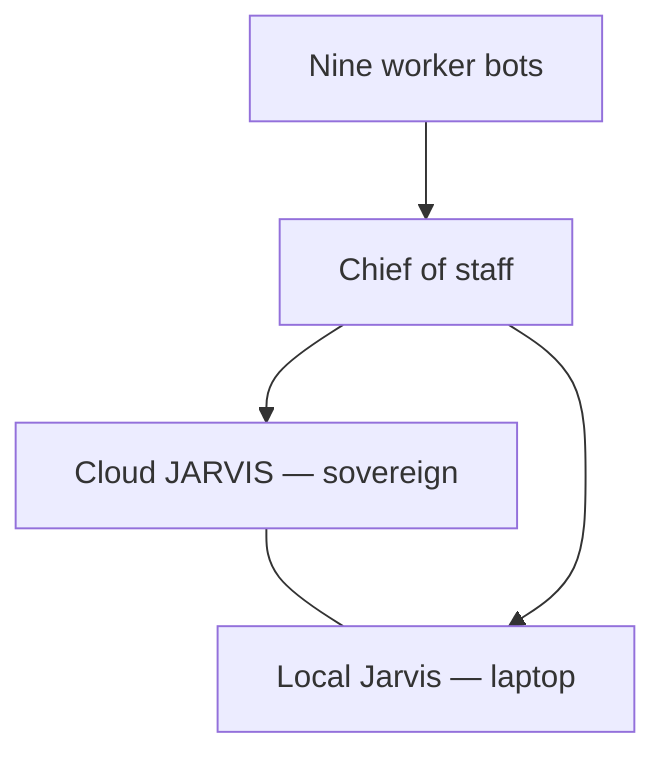
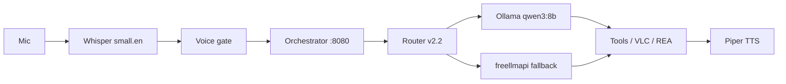

# J.A.R.V.I.S.

**Joint Ambient Ready Variance Intelligence System**

One operator. Durable roles. Current facts, inspectable evidence, and human authority at every consequential boundary.

[](https://github.com/basementjarvisunleashed-a11y/jarvis-estate/actions/workflows/validate.yml)
[](LICENSE)
[](https://github.com/basementjarvisunleashed-a11y/jarvis-estate/commits/main)

**Estate 1.2.0.** The version file is [`VERSION`](VERSION). Estate 1.1.0 was the roster. The release tag before that remains `v1.0.0`. The public site is [GitHub Pages](https://basementjarvisunleashed-a11y.github.io/jarvis-estate/).

## Contents

- [Recent](#recent)
- [Overview](#overview)
- [Architecture](#architecture)
- [Bot roster](#bot-roster)
- [Get Local Jarvis](#get-local-jarvis)
- [Repository structure](#repository-structure)
- [Security](#security)
- [Contributing](#contributing)
- [License](#license)

## Recent

Estate **1.2.0** is the operations log of 2026-10-27, morning to night. HgX commissioned it at 00:26 America/Toronto on 2026-10-28. The full note is [`docs/logs/2026-10-27.md`](docs/logs/2026-10-27.md).

- Router v2.2 went live at 17:28. The voice budget is 50 seconds. The client waits 60 seconds. freellmapi is the fallback only.
- Code, pull requests, and router work go to The Plugin Armoury. Security Audit Force is the security gate.
- Grok Bot's computer filled its disk, locked out, and was recovered. An hourly disk watch alerts at 45% and caps at 50%.
- That night, four startup apps were disabled through StartupApproved (Discord, Acrobat Sync, Edge autolaunch, Firefox). The disable can be undone. ComfyUI VRAM was freed. `qwen3:8b` stays warm for voice.
- REA's quick wins and larger items are waiting on Security Audit Force's GO. The fallback address is not published.
- Graphify's how-to is `update`, `explain`, `path`, and `affected`. Graphs are indexed in [`INDEX.md`](INDEX.md#graphs).

House rules for this version: no deletions; a pull request for every GitHub change; no secrets in public; approval for each laptop change.

## Overview

J.A.R.V.I.S. is an operating system for a personal AI estate. Named roles own durable jobs. Changing facts are re-read from the system that owns them. A fluent "done" is not proof: consequential work ends in an artifact the operator can inspect. Nothing is sent, spent, published, or deleted without explicit approval.

The operator is **HgX**. Personal details stay off the public tree.

On 2026-10-27 the live estate has three command roles and nine worker bots:

- **Cloud JARVIS** is the cloud brain and the sovereign of the estate.
- **Local Jarvis** runs on the owner's laptop. It uses Ollama `qwen3:8b`, an orchestrator on port 8080, and voice through Whisper and Piper. Router v2.2 went live the same day at 17:28 America/Toronto. A voice turn has a 50 second budget. The client waits 60 seconds. freellmapi is the fallback only, and only when Ollama is down.
- **Chief of staff** coordinates the worker bots and reports to Cloud JARVIS and to Local Jarvis.

The custody loop is unchanged:

**Role → live source → tool → artifact → evidence → approval → routine**

House rules from 1.2.0: nothing is deleted; every GitHub change is a pull request; nothing secret is published; each laptop change needs approval. Every bot answers by voice memo. The day record is [`docs/logs/2026-10-27.md`](docs/logs/2026-10-27.md).

This repository is the public record: doctrine, skills, the formal programme, Watchtower, the laptop build, and the estate record above. Doctoral programme, as of 2026-10-27: Phases 0–5 are closed. Phase 6 (router optimality) is open. Evidence is in [`EVIDENCE.md`](EVIDENCE.md).

ComfyUI v0.43.0 and freellmapi run on that laptop. They are estate facts. They are not installed by the downloadable `local-jarvis/` installer. About 15 free LLM provider keys were pooled on 2026-10-27 for The Free Model Gateway. No key material is in this repository. A box disk incident the same day was recovered. No host names or recovery steps are published.

## Architecture

Command sits with Cloud JARVIS. Local Jarvis is the laptop presence. The chief of staff coordinates the workers and reports to both.



A spoken turn on the laptop is audio in and audio out. Router v2.2, live at 17:28 America/Toronto on 2026-10-27, chooses the model. The budget for that turn is 50 seconds. The client waits 60 seconds. Plain VLC commands match a regex and skip the model. freellmapi is the fallback only, when Ollama is down.



`jarvis.py` is a separate helper on `qwen2.5:3b`. The voice loop does not use that model. VLC's HTTP remote and Ollama stay on localhost. The downloadable file map is in [`local-jarvis/README.md`](local-jarvis/README.md).

## Bot roster

Nine workers. Each has a persona. The chief of staff is the coordinator, not a tenth worker.

| Bot | Persona | What is public |
|---|---|---|
| Image Forge | Flamboyant Renaissance painter | ComfyUI v0.43.0 on the laptop |
| Security Audit Force | Noir detective | The security gate |
| OpenMuse | Serene Greek muse | OpenMuse |
| The Free Model Gateway | Brooklyn hustler | freellmapi; about 15 free LLM provider keys pooled 2026-10-27 |
| Memory | Scottish librarian | ai-memory |
| HyperFrames | Hollywood director | HyperFrames |
| The Plugin Armoury | Viking blacksmith | Code, pull requests, router, and orchestration |
| Codebase Cartographer | Victorian explorer | Graphify |
| REA, Reverse Engineer Anything | Cold War spy | REA |

Hand-off: code, pull requests, and router work go to The Plugin Armoury. Security Audit Force is the security gate.

The eight skill playbooks under [`skills/`](skills/) stay the written methods. They are not a second copy of this roster.

## Get Local Jarvis

The Windows laptop build is [`local-jarvis/`](local-jarvis/README.md). It does not start on its own. The voice loop is not a login item. The orchestrator listens on port 8080 only after you start it.

Router v2.2, the 50 second voice budget, the 60 second client wait, ComfyUI v0.43.0, and the freellmapi fallback are live on the owner's laptop. freellmapi is the fallback only. `install.ps1` does not install them.

Tested on Windows 10/11 with an NVIDIA GPU (reference card: RTX 2060 6GB). CPU Whisper works without the GPU.

1. Install Python 3.13, [Ollama](https://ollama.com/download), and the two models named in the guide (`qwen3:8b` for the orchestrator, `qwen2.5:3b` for `jarvis.py`).
2. From `local-jarvis/`:

   ```powershell
   powershell -ExecutionPolicy Bypass -File .\install.ps1
   ```

3. Set passwords and the Windows account on the machine. The tree ships placeholders only (`CHANGE_ME`, `<user>`). Do not commit the real values.
4. Start the orchestrator with `py -3.13 C:\Jarvis\orchestrator.py` and open `http://localhost:8080`.
5. Enroll the speaker before trusting the voice gate. The threshold starts at **0.45** and is **uncalibrated**.

`install.ps1` is idempotent. It does not register scheduled tasks unless you pass `-RegisterTasks`, and it refuses that flag while placeholders are still in the task XML. Full steps, Piper voice files, VLC, and troubleshooting are in [`local-jarvis/README.md`](local-jarvis/README.md).

## Repository structure

| Path | What it is |
|---|---|
| [`VERSION`](VERSION) | Estate version. **1.2.0**. 1.1.0 was the roster. The prior release tag is `v1.0.0`. |
| [`docs/logs/2026-10-27.md`](docs/logs/2026-10-27.md) | Operations log for 2026-10-27. |
| [`local-jarvis/`](local-jarvis/README.md) | Downloadable Windows build: voice loop, orchestrator, `install.ps1`. Live 2026-10-27. |
| [`skills/`](skills/) | Eight role playbooks. Duties do not cross. |
| [`watchtower/`](watchtower/README.md) | Stdlib monitor and [`STATUS.md`](watchtower/STATUS.md). Paused is a decision, not an outage. |
| [`papers/`](papers/README.md) | White-paper index. Current versions and the Dropbox URLs. |
| [`formal-spec/`](formal-spec/ROADMAP.md) | Contracts, the TLA+ state machine, and the phase record. |
| [`academy/`](academy/README.md) | Course index, history, decks, and lecture records. |
| [`release-log/`](release-log/) | Dated build logs, America/Toronto. |
| [`research/`](research/README.md) | Published research notes, one folder per day. |
| [`audits/`](audits/TEMPLATE.md) | Audit template and weekly audits. |
| [`scores/`](scores/README.md) | Stability rubric and history. |
| [`website/index.html`](website/index.html) | Archived white-paper hub. The live homepage is the root `index.html`. |
| [`INDEX.md`](INDEX.md) | Short map of the same tree. |

Eight skills: `tickler-bot`, `bitcoin-x-memes`, `betting-engine`, `gameday-bot`, `overlord-bot`, `tax-bot`, `team-deployment`, `usage-router`. Each `SKILL.md` has the same anatomy: purpose, workflow, output contract, operating rules.

## Security

This tree is sanitized on purpose.

- No real names, home addresses, public IPs, Wi-Fi details, tokens, Windows usernames, or voice recordings belong here. Refer to the operator as HgX.
- Passwords in `local-jarvis/` are the placeholder `CHANGE_ME`. Set them on the machine.
- Voice profiles, enrollment audio, and model weights stay local. They are gitignored.
- The voice path, VLC, and Ollama bind to localhost. The orchestrator listens on port 8080 on the PC that runs it.
- The build has no delete tool. File tools stay inside the configured roots.
- House rules recorded with estate 1.2.0: no deletions; a pull request for every GitHub change; no secrets in public; approval for each laptop change. Security Audit Force is the security gate. Every bot answers by voice memo. The 1.1.0 record said the same thing in shorter form.
- Provider keys for the free-model pool are not in this repository. The public fact is the count: about 15 keys pooled on 2026-10-27.

Report vulnerabilities the way [`SECURITY.md`](SECURITY.md) describes. Do not open a public issue for a secret.

## Contributing

Read [`CONTRIBUTING.md`](CONTRIBUTING.md) and [`CODE_OF_CONDUCT.md`](CODE_OF_CONDUCT.md). Issues and pull requests use the templates in [`.github/`](.github/pull_request_template.md).

Versions only move forward ([`VERSIONING.md`](VERSIONING.md)). User-visible changes get a [`CHANGELOG.md`](CHANGELOG.md) entry. Historical logs are not rewritten to match later facts; a correction is a new note. The estate version in [`VERSION`](VERSION) moves on its own line. Contract and paper versions do not move with it.

## License

Two licenses already cover this repository. Nothing new was added.

- Code, skills, and tooling: [MIT](LICENSE). Copyright (c) 2026 @hgxengineering.
- White papers and documentation: [CC-BY-4.0](LICENSE-CC-BY-4.0).

Build your own estate.
