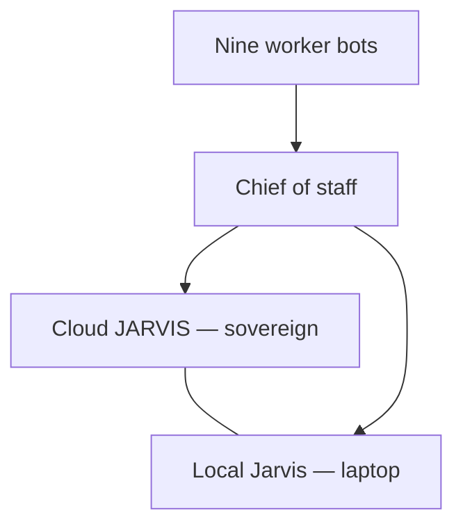
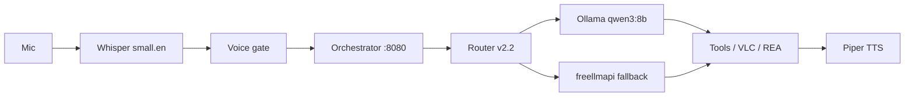

# J.A.R.V.I.S.

## **J**oint **A**mbient **R**eady **V**ariance **I**ntelligence **S**ystem

> 🔥 **Kali Linux. REA. The basement laptop that can rip apart anything.**
>
> One operator. Durable roles. Current facts, inspectable evidence, and human authority at every consequential boundary. Cloud JARVIS is the sovereign. Local Jarvis runs on Kali Linux in the basement lab — and it can rip apart anything, then put it back together with evidence.

**Estate 1.2.1.** The version file is [`VERSION`](VERSION). The public site is [GitHub Pages](https://basementjarvisunleashed-a11y.github.io/jarvis-estate/).

### The basement lab

| | |
|---|---|
| 🔥 **Kali Linux** | Everything installed on the internal drive. All tools updated, graphics driver in, Bluetooth working, Wi-Fi working, login working. |
| 🔬 **REA 6.7.0** | Reverse Engineer Anything, ready for local app analysis. `npx rea-agents analyze /path/to/app`. Ghidra guided workflows installed. |
| 💻 **The machine** | Acer Nitro AN515-55. i7-10750H. 64GB RAM. RTX 2060, about 6GB VRAM. 512GB NVMe. |
| 🎓 **OPERATOR PRIME — HGX Academy** | The one-year open source course, taught by HGX Academy — HgX's own academy. Full-Spectrum Operator Systems. Labs L1–L20 locked. 272 course files: canon, Dean batches 1–3, student packs, year pack, professor pack, professor skill, Academy action log. [Course website](course/) · [Course index](course/README.md). |

## Contents

- [Recent](#recent)
- [Overview](#overview)
- [1.0 — the course is embedded, not separate](#10--the-course-is-embedded-not-separate)
- [Architecture](#architecture)
- [Bot roster](#bot-roster)
- [Get Local Jarvis](#get-local-jarvis)
- [Repository structure](#repository-structure)
- [Security](#security)
- [Contributing](#contributing)
- [License](#license)

## Recent

### 2026-11-07 — GitHub reconciled with the laptop build

The repo now matches the Acer, file for file. The Acer source snapshot
(`jarvis-acer-source-2026-11-06.zip`, 155,653 bytes) landed: the live
router, the live orchestrator and voice loop (Kali versions, patch v5
applied), the autostart launchers, and the C270 captures — all scrubbed
and published under [`local-jarvis/`](local-jarvis/). The GPU
orchestrator is **DEPLOYED** (2026-11-06 ~23:50 ET): router wired, autostart
in, keep-alive v2 in, and the swap loop proven end to end (ComfyUI freed
the card to 132 MiB; one easy call brought the 9B back, both brains
resident). The run-it-yourself guide ([`local-jarvis/SETUP.md`](local-jarvis/SETUP.md))
now carries the full reference machine. Still to land: the iPad Kali
downloads (sources only, never the installers) and dashboard v8 — built
and verified, awaiting HgX's word, not applied, not published.

### 2026-11-04 — the Academy day (Estate 1.2.1)

HGX Academy, HgX's own academy, published its full day in the open. The course website is rebuilt to academy standard ([Latest](course/#latest), [Transparency](course/#transparency), [Academy log](course/#academy-log)). **272 course files** on main.

- **Dean year pack** — 100 files + index, DRAFT v0.1.0: 52 weekly packs, 12 monthly assignments, 17 audits, 15 blank examinations, 3 facility packs, Year Games. In [`course/year/`](course/year/).
- **Professor teaching pack** — 100 files + index, DRAFT v0.1.0: master guide, 15 module guides, 52 weekly guides, 12 monthly plans, 12 marking guides (criteria only — no exam key, no model answer), 4 quarterly reviews, final year review, 3 facility guides. In [`course/professor/`](course/professor/).
- **Professor skill** — DRAFT v0.1.0, the core spot in one file: role, Dean hierarchy, posture order (ask the Dean, don't ask HgX), Day 1 decided (L1 Digital Twin, prepared, not dated), feed rhythm (weekly feed at week start, daily feed the evening before, monthly feed at month start — one source, not two). In [`course/professor/skill/`](course/professor/skill/).
- **Academy Action Log 2026-11-04** — the Dean's full day, filed verbatim under Academy Bot. In [`course/academy/`](course/academy/).
- **Local Jarvis stack record** — core, Kali built, REA 6.7.0 built, voice stack built, and the entire pending stack (dual brain, seventeen stacks, Kali tools to REA mapping, Project 25) each marked BUILT or PENDING. In [`local-jarvis/LOCAL-JARVIS-STACK.md`](local-jarvis/LOCAL-JARVIS-STACK.md).
- **Macro, defined by HgX (2026-11-04 16:39 ET)** — macro means HGX Academy will teach a lot more things: a lot of other courses in the future, beyond OPERATOR PRIME. It is not this course growing sideways, and it is not a different university. Future courses are separate, later, on his word — none named, dated, or promised here. The Dean holds scaling and future courses; the professor teaches OPERATOR PRIME.
- **Parked, not pressing (HgX, 2026-11-04 16:39 ET)** — cohort locks (year, start date, times, venues, buffers) parked, not asked about. Embedded-1.0 correction now LOCKED as 1.0 (2026-11-04 16:48 ET); labs L21–L50 locked for 1.0 (Addendum 2, 16:52 ET).
- **Standing rule, unchanged** — nothing to students until HgX approves the exact content for that use.
- **1.0 LOCKED 2026-11-04 (16:48 ET)** — HgX confirmed (Yes / Approved / Go 1.0) in the Academy room; the Dean ruled and issued it. Scope: course + all open-source hardware used in the course + bracelet, all open source. 247 files upgraded to APPROVED v1.0.0 as new files alongside their drafts, plus the professor skill v1.0.0 and the Academy log addendum. Batch 2 templates only, labs L21–L50 now LOCKED for 1.0 (Addendum 2), no cohort/date/venue/fee locked. See the [course README](course/README.md) and the [master approved index](course/INDEX-APPROVED-v1.0.0.md).
- **GitHub verified tonight** — all 13 open issues, all 7 discussions, all 12 wiki pages current; milestones verified: Phases 0–5 CLOSED, Phase 6 OPEN, Phase 7 awaits HgX's word. Weekly audit 2026-W45 (stability 100) filed in [`audits/weekly/`](audits/weekly/).

### 2026-10-27 — Estate 1.2.0 operations log

Estate **1.2.0** is the operations log of 2026-10-27, morning to night. HgX commissioned it at 00:26 America/Toronto on 2026-10-28. The full note is [`docs/logs/2026-10-27.md`](docs/logs/2026-10-27.md).

- Router v2.2 went live at 17:28. The voice budget is 50 seconds. The client waits 60 seconds. freellmapi is the fallback only.
- Code, pull requests, and router work go to The Plugin Armoury. Security Audit Force is the security gate.
- Grok Bot's computer filled its disk, locked out, and was recovered. An hourly disk watch alerts at 45% and caps at 50%.
- That night, four startup apps were disabled through StartupApproved (Discord, Acrobat Sync, Edge autolaunch, Firefox). The disable can be undone. ComfyUI VRAM was freed. `qwen3:8b` stays warm for voice.
- REA's night changelog was cleared by Security Audit Force. Each cleared item has a backup. Still open: the FreeLLMAPI fallback returns 503 with 0 provider keys, and the VoiceMeeter task error. sshd hardening and a reboot wait on HgX. No address is published.
- Graphify's how-to is `update`, `explain`, `path`, and `affected`. Graphs are indexed in [`INDEX.md`](INDEX.md#graphs).

House rules for this version: no deletions; a pull request for every GitHub change; no secrets in public; approval for each laptop change.

## Overview

J.A.R.V.I.S. is an operating system for a personal AI estate. Named roles own durable jobs. Changing facts are re-read from the system that owns them. A fluent "done" is not proof: consequential work ends in an artifact the operator can inspect. Nothing is sent, spent, published, or deleted without explicit approval.

The operator is **HgX**. Personal details stay off the public tree.

On 2026-10-27 the live estate has three command roles and nine worker bots:

- **Cloud JARVIS** is the cloud brain and the sovereign of the estate.
- **Local Jarvis** runs on the owner's laptop. It uses Ollama `qwen3:8b`, an orchestrator on port 8080, and voice through Whisper and Piper. Router v2.2 went live the same day at 17:28 America/Toronto. A voice turn has a 50 second budget. The client waits 60 seconds. freellmapi is the fallback only, and only when Ollama is down.
- **Chief of staff** coordinates the worker bots and reports to Cloud JARVIS and to Local Jarvis.

The custody loop is unchanged:

**Role → live source → tool → artifact → evidence → approval → routine**

House rules from 1.2.0: nothing is deleted; every GitHub change is a pull request; nothing secret is published; each laptop change needs approval. Every bot answers by voice memo. The day record is [`docs/logs/2026-10-27.md`](docs/logs/2026-10-27.md).

This repository is the public record: doctrine, skills, the formal programme, Watchtower, the laptop build, and the estate record above. Doctoral programme, as of 2026-11-04: Phases 0–5 are closed. Phase 6 (router optimality) is open. Phase 7 awaits HgX's word. Evidence is in [`EVIDENCE.md`](EVIDENCE.md).

## 1.0 — the course is embedded, not separate

**1.0 is the whole open-source system, and the course is embedded inside it — not a separate product, not a side pipeline.** 1.0 = the course + all open-source hardware used in the course + the bracelet, all open source. The bracelet is one device in 1.0, not the whole of 1.0.

- **The course:** OPERATOR PRIME — Full-Spectrum Operator Course, taught by **HGX Academy**, HgX's own academy. Modules M0–M14, Labs L1–L20, Project 25, 21 checkpoints, assessment 40/25/15/20. See the [course website](course/) and [course index](course/README.md).
- **The hardware:** All open-source hardware used in the course is part of 1.0. Hardware H1–H20 in hand, H21–H30 draft. Kali Linux everything, REA `rea-agents@6.7.0`, the basement lab laptop that can rip apart anything.
- **The bracelet:** One device in 1.0, not the whole of 1.0. The wrist proof of concept, the offline-first link, the T-Watch-S3 + LoRa — one piece of the open-source system.
- **How the next version is built:** Students take the course in an open-source manner — operate, document, log, prevent, own targets only, consenting adults, controlled lab only. What they learn, and what we learn from them — what worked, what broke, what tools were missing, what evidence logs looked like, what operators struggled with, what hardware failed, what workflows were too slow or super fast — taken scrubbed, with consent, no personal data, is how the next version is built. Service design from real student operations, not just a workforce pipeline, not just bracelet sales.

ComfyUI v0.43.0 and freellmapi run on that laptop. They are estate facts. They are not installed by the downloadable `local-jarvis/` installer. About 15 free LLM provider keys were pooled on 2026-10-27 for The Free Model Gateway. No key material is in this repository. A box disk incident the same day was recovered. No host names or recovery steps are published.

## Architecture

Command sits with Cloud JARVIS. Local Jarvis is the laptop presence. The chief of staff coordinates the workers and reports to both.

A spoken turn on the laptop is audio in and audio out. Router v2.2, live at 17:28 America/Toronto on 2026-10-27, chooses the model. The budget for that turn is 50 seconds. The client waits 60 seconds. Plain VLC commands match a regex and skip the model. freellmapi is the fallback only, when Ollama is down.

`jarvis.py` is a separate helper on `qwen2.5:3b`. The voice loop does not use that model. VLC's HTTP remote and Ollama stay on localhost. The downloadable file map is in [`local-jarvis/README.md`](local-jarvis/README.md).

## Bot roster

Nine workers. Each has a persona. The chief of staff is the coordinator, not a tenth worker.

| Bot | Persona | What is public |
|---|---|---|
| Image Forge | Flamboyant Renaissance painter | ComfyUI v0.43.0 on the laptop |
| Security Audit Force | Noir detective | The security gate |
| OpenMuse | Serene Greek muse | OpenMuse |
| The Free Model Gateway | Brooklyn hustler | freellmapi; about 15 free LLM provider keys pooled 2026-10-27 |
| Memory | Scottish librarian | ai-memory |
| HyperFrames | Hollywood director | HyperFrames |
| The Plugin Armoury | Viking blacksmith | Code, pull requests, router, and orchestration |
| Codebase Cartographer | Victorian explorer | Graphify |
| REA, Reverse Engineer Anything | Cold War spy | REA |

Hand-off: code, pull requests, and router work go to The Plugin Armoury. Security Audit Force is the security gate.

The eight skill playbooks under [`skills/`](skills/) stay the written methods. They are not a second copy of this roster.

## Get Local Jarvis

The laptop platform is [`local-jarvis/`](local-jarvis/README.md). It does not start on its own. The voice loop is not a login item. The orchestrator listens on port 8080 only after you start it.

**Platform as of 2026-11-04: Kali Linux on the internal drive.** The laptop runs Kali Linux with all tools updated, graphics driver installed, Bluetooth and Wi-Fi working, and login working. Windows is no longer on the internal drive. The Windows licence is motherboard-tied; a later reinstall via ISO is possible with no product key needed. The local-jarvis guide is rewritten for Kali Linux; the prior Windows guide is preserved in git history. The live platform is Kali Linux. See [`local-jarvis/PLATFORM-KALI.md`](local-jarvis/PLATFORM-KALI.md) for the current platform record.

Router v2.2, the 50 second voice budget, the 60 second client wait, ComfyUI v0.43.0, and the freellmapi fallback are live on the owner's laptop. freellmapi is the fallback only.

Hardware: Acer Nitro AN515-55, i7-10750H, 64GB RAM, RTX 2060 (about 6GB VRAM), 512GB NVMe internal drive. CPU Whisper works without the GPU.

REA is ready for local app analysis: `rea-agents@6.7.0`, installed via `npx rea-agents setup`, with the REA reverse-engineering skill for CLI use. CLI: `npx rea-agents analyze /path/to/app`. Deep analysis uses Ghidra with guided reverse-engineering workflows installed.

Planned, not yet built: Ollama check, a 4B abliterated local model resident on VRAM as the fast low-end brain, a 27B abliterated local model on RAM as the slow high-end brain, switching logic in the orchestrator layers and usage router (default VRAM fast, escalate to RAM high for hard tasks, de-escalate back), then the remaining software stacks in efficient order, Kali tools mapping into REA, and Project 25 prove-out. No middle 8B test. None of these are claimed as installed until confirmed built. The full consolidated record — core, Kali, REA, and the entire pending stack, each item marked BUILT or PENDING — is [`local-jarvis/LOCAL-JARVIS-STACK.md`](local-jarvis/LOCAL-JARVIS-STACK.md).

1. Install Python 3.13, [Ollama](https://ollama.com/download), and the two models named in the guide (`qwen3:8b` for the orchestrator, `qwen2.5:3b` for `jarvis.py`).
2. Set passwords and the user account on the machine. The tree ships placeholders only (`CHANGE_ME`, `<user>`). Do not commit the real values.
3. Start the orchestrator and open `http://localhost:8080`.
4. Enroll the speaker before trusting the voice gate. The threshold starts at **0.45** and is **uncalibrated**.

Full steps, Piper voice files, VLC, and troubleshooting are in [`local-jarvis/README.md`](local-jarvis/README.md).

## Repository structure

| Path | What it is |
|---|---|
| [`VERSION`](VERSION) | Estate version. **1.2.1**. 1.2.0 was the 2026-10-27 operations log. The prior release tag is `v1.0.0`. |
| [`docs/logs/2026-10-27.md`](docs/logs/2026-10-27.md) | Operations log for 2026-10-27. |
| [`local-jarvis/`](local-jarvis/README.md) | Laptop platform: Kali Linux build (live 2026-11-04) with voice loop, orchestrator, and REA. Guide rewritten for Kali; prior Windows guide in git history. |
| [`local-jarvis/LOCAL-JARVIS-STACK.md`](local-jarvis/LOCAL-JARVIS-STACK.md) | Consolidated stack record: core, Jarvis on Kali (built), REA (built), voice stack (built), and the entire pending stack — dual brain, seventeen stacks in efficient order, Kali tools → REA mapping, Project 25 prove-out — each item marked BUILT or PENDING. |
| [`skills/`](skills/) | Eight role playbooks. Duties do not cross. |
| [`watchtower/`](watchtower/README.md) | Stdlib monitor and [`STATUS.md`](watchtower/STATUS.md). Paused is a decision, not an outage. |
| [`papers/`](papers/README.md) | White-paper index. Current versions and the Dropbox URLs. |
| [`formal-spec/`](formal-spec/ROADMAP.md) | Contracts, the TLA+ state machine, and the phase record. |
| [`academy/`](academy/README.md) | Course index, history, decks, and lecture records. |
| [`release-log/`](release-log/) | Dated build logs, America/Toronto. |
| [`research/`](research/README.md) | Published research notes, one folder per day. |
| [`audits/`](audits/TEMPLATE.md) | Audit template and weekly audits. |
| [`scores/`](scores/README.md) | Stability rubric and history. |
| [`website/index.html`](website/index.html) | Archived white-paper hub. The live homepage is the root `index.html`. |
| [`INDEX.md`](INDEX.md) | Short map of the same tree. |

Eight skills: `tickler-bot`, `bitcoin-x-memes`, `betting-engine`, `gameday-bot`, `overlord-bot`, `tax-bot`, `team-deployment`, `usage-router`. Each `SKILL.md` has the same anatomy: purpose, workflow, output contract, operating rules.

## Security

This tree is sanitized on purpose.

- No real names, home addresses, public IPs, Wi-Fi details, tokens, Windows usernames, or voice recordings belong here. Refer to the operator as HgX.
- Passwords in `local-jarvis/` are the placeholder `CHANGE_ME`. Set them on the machine.
- Voice profiles, enrollment audio, and model weights stay local. They are gitignored.
- The voice path, VLC, and Ollama bind to localhost. The orchestrator listens on port 8080 on the PC that runs it.
- The build has no delete tool. File tools stay inside the configured roots.
- House rules recorded with estate 1.2.0: no deletions; a pull request for every GitHub change; no secrets in public; approval for each laptop change. Security Audit Force is the security gate. Every bot answers by voice memo. The 1.1.0 record said the same thing in shorter form.
- Provider keys for the free-model pool are not in this repository. The public fact is the count: about 15 keys pooled on 2026-10-27.

Report vulnerabilities the way [`SECURITY.md`](SECURITY.md) describes. Do not open a public issue for a secret.

## Contributing

Read [`CONTRIBUTING.md`](CONTRIBUTING.md) and [`CODE_OF_CONDUCT.md`](CODE_OF_CONDUCT.md). Issues and pull requests use the templates in [`.github/`](.github/pull_request_template.md).

Versions only move forward ([`VERSIONING.md`](VERSIONING.md)). User-visible changes get a [`CHANGELOG.md`](CHANGELOG.md) entry. Historical logs are not rewritten to match later facts; a correction is a new note. The estate version in [`VERSION`](VERSION) moves on its own line. Contract and paper versions do not move with it.

## License

Two licenses already cover this repository. Nothing new was added.

- Code, skills, and tooling: [MIT](LICENSE). Copyright (c) 2026 @hgxengineering.
- White papers and documentation: [CC-BY-4.0](LICENSE-CC-BY-4.0).

Build your own estate.
